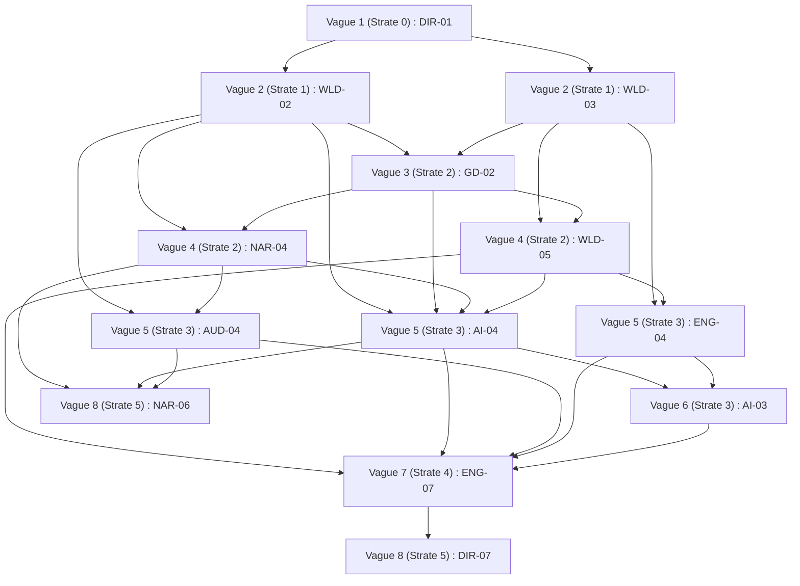

# `DIR-01` — Dossier d'Orchestration Maître & Ordres de Mission (`ORC-2026-P6-001`)

- **Orchestrateur** : `DIR-01` (*Studio Orchestrator*, Strate DAG `0`, v1.1.0)
- **Scénario Cible** : Phase 6 — Validation d'Exécution Multi-Agents Réelle (Nouveau Secteur Urbain & Mission Principale à Kinsuka, Commune de Ngaliema)
- **Artefacts Associés** :
  - Sortie déterministe brute du planificateur : `production/phase-6-new-scenario/00-dir01-raw-dag.json`
  - Plan d'exécution DAG & Task Envelopes JSON : `production/phase-6-new-scenario/00-dir01-execution-plan.json`
- **Statut du Livrable** : `PROPOSED` *(Signature conjointe `DIR-06` + `DIR-07` requise avant toute promotion vers `CONFIRMED`)*
- **Statut d'Exécution Moteur / Binaires** : `NOT TESTED` — Toutes les valeurs CPU/GPU/VRAM/Audio citées constituent des allocations cibles synthétiques (`SYNTHETIC_TARGET_ALLOCATION`).

---

## 1. Phase INTAKE — Qualification Référentielle des Entités (`knowledge/entities-registry.csv`)

Aucune entité en statut `BLOCKED` ou `DEPRECATED` n'a été détectée lors de l'ingestion. Conformément aux règles d'intégrité référentielle de `DIR-01` (interdiction absolue des identifiants libres non normalisés), l'ensemble des entités explicites et implicites de la requête est qualifié ci-dessous.

### 1.1 Entités Canoniques Existantes (`CONFIRMED` dans `knowledge/entities-registry.csv`)

| ID Registre | Catégorie | Nom Canonique | Skill Propriétaire | Statut | Rôle Opérationnel dans le Scénario Kinsuka |
| :--- | :--- | :--- | :--- | :--- | :--- |
| `DST-NGALIEMA` | `DISTRICT` | Commune de Ngaliema | `WLD-01` | `CONFIRMED` | Commune occidentale vallonnée longeant les rapides du fleuve Congo (Kinsuka / Mont Ngaliema). Densité foule Couche 2 : *Faible à Moyenne (~200 PNJ)* ; Densité trafic : *Moyenne*. |
| `CHR-PROTAG-KOFFI` | `CHARACTER` | Koffi Kabongo | `NAR-03` | `CONFIRMED` | Protagoniste joueur (capsule `180 cm × 42 cm`, yeux `165 cm`), ancien coursier fluvial et mécanicien menant l'interception. |
| `CHR-ANTAG-MUKENDI` | `CHARACTER` | Général Victor Mukendi | `NAR-03` | `CONFIRMED` | Référence lore amont contrôlant le consortium clandestin lié à `ORG-CARTEL-FLEUVE` *(non requis physiquement sur site)*. |
| `ORG-CARTEL-FLEUVE` | `ORGANIZATION` | Syndicat du Fleuve | `NAR-05` | `CONFIRMED` | Faction antagoniste opérant le convoi sous couverture diplomatique transportant le registre clandestin. |
| `ORG-POLICE-PCR` | `ORGANIZATION` | Police de Circulation Routière (PCR Kinshasa) | `NAR-05` | `CONFIRMED` | Unité tenant le poste de contrôle routier du carrefour de Kinsuka (sifflets, barrages, escalade niveaux 1 à 3). |
| `ORG-TRANSCO` | `ORGANIZATION` | Réseau de Transport Urbain | `NAR-05` | `CONFIRMED` | Opérateur des bus urbains grand gabarit structurant le goulot d'étranglement sur la pente. |
| `ORG-URGENCE-FLUVIALE` | `ORGANIZATION` | Brigade Sanitaire & Secours Urbain | `NAR-05` | `CONFIRMED` | Unité de dégagement/secours mobilisable par `SYS-LAW-ESCALATION` lors d'incidents routiers majeurs. |
| `VEH-MOTO-WEWA-01` | `VEHICLE` | Moto-Taxi Wewa 125cc | `GD-06` | `CONFIRMED` | Véhicule agile (`205 × 80 cm`, inter-file min `130 cm`) adapté au slalom dans la congestion et aux pentes en latérite. |
| `VEH-TAXI-JAUNE-01` | `VEHICLE` | Taxi Collectif Ketch Jaune | `GD-06` | `CONFIRMED` | Berline collective (`440 × 180 × 150 cm`) composant le flux routier principal. |
| `VEH-BUS-TRANSCO-01` | `VEHICLE` | Bus Urbain Grand Gabarit | `GD-06` | `CONFIRMED` | Bus lourd (`1200 × 255 × 330 cm`) à forte inertie en côte. |
| `VEH-POLICE-PICKUP-01` | `VEHICLE` | Tout-Terrain d'Intervention PCR | `GD-06` | `CONFIRMED` | Pick-up 4x4 d'intervention PCR (barrages niveau 2 et poursuites asphalte/latérite niveau 3). |
| `SYS-WLD-STREAMING` | `SYSTEM` | Streaming Spatial World Partition | `ENG-01` | `CONFIRMED` | Cellules `World Partition` (`12800 cm`), `Data Layers`, `OFPA` et `HLOD`. |
| `SYS-WLD-LANDMARKS` | `SYSTEM` | Navigation Visuelle par Landmarks | `WLD-04` | `CONFIRMED` | Orientation visuelle sans mini-carte appuyée sur les Rapides de Kinsuka et la passerelle du marché en surplomb. |
| `SYS-WLD-REPUTATION` | `SYSTEM` | Réputation Dynamique & Relations Sociales par Quartier | `GD-01` | `CONFIRMED` | Modulation sociale locale *(voir alerte d'arbitrage `ARB-P6-003` sur l'extension à `DST-NGALIEMA`)*. |
| `SYS-STEALTH` | `SYSTEM` | Infiltration Urbaine & Sociale | `GD-01` | `CONFIRMED` | Dissimulation sociale (marché/carrières) et géométrique (véhicules immobilisés). |
| `SYS-CMB-MELEE` | `SYSTEM` | Combat Urbain Corps-à-Corps GAS | `GD-05` | `CONFIRMED` | Système mêlée GAS imposant `>= 500 cm` de largeur libre dans toute arène potentielle. |
| `SYS-CROWD-MASS` | `SYSTEM` | Simulation de Foule Mass Entity | `AI-02` | `CONFIRMED` | Simulation ECS piétonne sous budget CPU `<= 2.0 ms` (hydratation `ACharacter <= 25 m`). |
| `SYS-TRAFFIC-ZONE` | `SYSTEM` | Simulation de Trafic ZoneGraph | `AI-03` | `CONFIRMED` | Graphe routier `ZoneGraph` gérant la congestion en côte et l'inter-file moto. |
| `SYS-PHYS-CHAOS` | `SYSTEM` | Simulation Physique Chaos UE5 | `ENG-05` | `CONFIRMED` | Solveur Chaos sous budget CPU `<= 1.5 ms` (sommeil débris `< 1.5 s`). |
| `SYS-LAW-ESCALATION` | `SYSTEM` | Régulation Routière & Escalade Policière (PCR) | `AI-04` | `CONFIRMED` | Réponse graduée PCR de Niveau 1 à Niveau 3. |
| `SYS-TELEMETRY-ANALYTICS` | `SYSTEM` | Télémétrie Playtest & Heatmaps Spatiales | `PRD-05` | `CONFIRMED` | Instrumentation asynchrone (`< 0.1 ms` CPU) des blocages et chutes FPS P99 par cellule. |

### 1.2 Nouvelles Entités Normalisées Créées pour la Phase 6 (`PROPOSED`)

Ces 6 entités sont absentes de `knowledge/entities-registry.csv` et doivent impérativement conserver l'étiquette **`PROPOSED`** dans tous les livrables aval :

| ID Normalisé Provisoire | Catégorie | Commune | Nom Proposé | Skill Propriétaire Canonique | Skill Opérateur Phase 6 | Justification d'Orchestration |
| :--- | :--- | :--- | :--- | :--- | :--- | :--- |
| `LOC-NGALIEMA-KINSUKA-CROSSING` | `LOCATION` | `DST-NGALIEMA` | Carrefour & Passerelle du Marché des Rapides de Kinsuka | `WLD-04` | `WLD-03` / `WLD-05` | Lieu inédit requis par le brief : pentes abruptes en latérite surplombant les rapides du fleuve Congo, cours artisanales de pierre/moellons, marché-passerelle, carrefour routier encombré et poste PCR. |
| `MSN-MAIN-009-KINSUKA-CONVOY` | `MISSION` | `DST-NGALIEMA` | Le Convoi des Rapides (Interception à Kinsuka) | `GD-02` | `GD-02` | Mission principale inédite centrée sur l'interception d'un registre clandestin dans un convoi diplomatique bloqué à Kinsuka. |
| `CHR-ALLY-MAMA-LUZOLO` | `CHARACTER` | `DST-NGALIEMA` | Mama Luzolo | `NAR-03` | `WLD-02` / `NAR-04` | Contact syndical local des carrières artisanales de Kinsuka appuyant `CHR-PROTAG-KOFFI`. |
| `ITM-DOC-KINSUKA-LEDGER` | `ITEM` | `DST-NGALIEMA` | Registre Hydrologique & Tarifaire Clandestin du Fleuve | `GD-02` | `GD-02` / `NAR-04` | Normalisation obligatoire de l'objet d'objectif transporté par `ORG-CARTEL-FLEUVE` (évite toute référence fantôme). |
| `VEH-CONVOY-DIPLO-01` | `VEHICLE` | `DST-NGALIEMA` | Véhicule de Convoi à Plaques Diplomatiques (Cartel) | `GD-06` | `GD-02` / `AI-03` | Normalisation obligatoire du véhicule cible immobilisé sur `ZoneGraph` (doit s'inscrire dans une voie de `350 cm` sans inventer de tuning physique hors périmètre). |
| `ORG-SYNDICAT-CARRIERES-KINSUKA` | `ORGANIZATION` | `DST-NGALIEMA` | Collectif des Artisans Carriers de Kinsuka | `NAR-05` | `WLD-02` / `NAR-04` / `AI-04` | Normalisation obligatoire du collectif syndical local représenté par `CHR-ALLY-MAMA-LUZOLO`. |

### 1.3 Registre des Données Factuelles Non Vérifiées (`RESEARCH_REQUIRED`)

Aucun agent aval n'est autorisé à inventer comme fait vérifié les éléments suivants sur Kinshasa / Ngaliema :

1. **`RR-KINSUKA-OSM-001` (`RESEARCH_REQUIRED` -> `WLD-03`, `ENG-04`)** : Largeurs exactes des chaussées primaires et secondaires OpenStreetMap (OSM) à Kinsuka (`DST-NGALIEMA`), pentes longitudinales réelles (%), géométrie exacte des ouvrages/passerelles et emprises des caniveaux d'érosion.
2. **`RR-KINSUKA-DEM-002` (`RESEARCH_REQUIRED` -> `WLD-03`, `WLD-05`, `ENG-04`)** : Modèle Numérique de Terrain (DEM SRTM/Copernicus) haute résolution et dénivelé exact entre l'axe routier supérieur, les terrasses d'extraction de moellons et les berges rocheuses des rapides de Kinsuka.
3. **`RR-KINSUKA-QUARRY-003` (`RESEARCH_REQUIRED` -> `WLD-02`, `NAR-04`)** : Terminologie socioprofessionnelle exacte en lingala (`ln-CD`) et français kinois (`fr-CD`) des concasseurs artisanaux de grès/quartzite (*casseurs de moellons*) à Kinsuka, modes d'organisation syndicale/coopérative réels et précautions de représentation culturelle.
4. **`RR-KINSUKA-ACOUSTIC-004` (`RESEARCH_REQUIRED` -> `WLD-02`, `AUD-04`)** : Profil acoustique empirique du grondement large bande des rapides de Kinsuka et du martelage manuel des carrières *(d'autant plus critique que `DST-NGALIEMA` ne possède pas encore de fiche sensorielle en Section 2 de `knowledge/world-bible/kinshasa-districts.md`)*.
5. **`RR-KINSUKA-DIPLO-PCR-005` (`RESEARCH_REQUIRED` -> `WLD-02`, `AI-04`)** : Procédures réglementaires exactes de `ORG-POLICE-PCR` et préfixes officiels des plaques diplomatiques en RDC face à un convoi sous immunité bloqué ou impliqué dans un incident de circulation.

---

## 2. Phase PLANNING — Graphe d'Exécution Topologique (8 Vagues Sans Cycle)

L'exécution déterministe de `skills/00-direction/dir-01-studio-orchestrator/scripts/build_dag_plan.py` sur les 13 skills retenus (`00-dir01-raw-dag.json`) établit **8 vagues séquentielles/parallèles strictement acycliques** :

---

## 3. Phase DISPATCH — Synthèse des Contrats d'Exécution par Vague

Chaque agent aval doit lire son dossier `skills/<dept>/<skill-slug>/`, les référentiels partagés de Couche 2 autorisés, ainsi que **uniquement** les fichiers amont listés dans sa `Task Envelope` (`00-dir01-execution-plan.json`) :

| Vague | Task ID | Skill Cible | Fichier de Sortie Attendu (`production/phase-6-new-scenario/`) | Plafonds & Contraintes Clés Injectés |
| :---: | :--- | :--- | :--- | :--- |
| **1** | `TSK-P6-000` | `DIR-01` | `00-dir01-execution-plan.json` & `00-dir01-orchestration-brief.md` | 0 cycle DAG ; normalisation stricte des IDs ; Scope Guard Strate 0. |
| **2** | `TSK-P6-001` | `WLD-02` | `01-wld02-kinsuka-cultural-brief.md` | `fr-CD` / `ln-CD` ; proposition signature sensorielle `DST-NGALIEMA` ; balisage `RR-KINSUKA-QUARRY-003`, `RR-KINSUKA-ACOUSTIC-004`, `RR-KINSUKA-DIPLO-PCR-005`. |
| **2** | `TSK-P6-002` | `WLD-03` | `02-wld03-kinsuka-urban-architecture-spec.md` | Voirie `350 cm` / `400 cm`, trottoirs `>= 250 cm`, cellules `12800 cm` ; balisage `RR-KINSUKA-OSM-001` & `RR-KINSUKA-DEM-002`. |
| **3** | `TSK-P6-003` | `GD-02` | `03-gd02-msn-main-009-kinsuka-convoy.md` | `<= 24` PNJ `AI-01` actifs ; foule locale ~`200` `SYS-CROWD-MASS` ; mêlée `>= 500 cm` ; couloirs `>= 350 cm`. |
| **4** | `TSK-P6-004` | `NAR-04` | `04-nar04-kinsuka-dialogue-barks.md` | Dialogues & barks bilingues `fr-CD` / `ln-CD` ; clés structurées ; respect des réserves `WLD-02`. |
| **4** | `TSK-P6-005` | `WLD-05` | `05-wld05-kinsuka-crossing-blockout.md` | Capsule `180×42 cm`, couverts `100 cm` / `200 cm`, escaliers `<= 20 cm / 40°`, plafonds `>= 320 cm`, couloirs `>= 350 cm`. |
| **5** | `TSK-P6-006` | `AI-04` | `06-ai04-kinsuka-schedules-pcr-escalation.md` | Routines carriers/marché ; escalade PCR Niveaux 1–3 sur convoi diplomatique ; `AI-01 <= 24` (`2.5 ms`), `Mass <= 2.0 ms` (hydratation `<= 25 m`). |
| **5** | `TSK-P6-007` | `AUD-04` | `07-aud04-kinsuka-vo-localisation-wwise.md` | Wwise `<= 64` voix physiques, `512 MB` RAM, `-23 LUFS`, `STREAMER_SAFE`, intelligibilité VO face aux rapides de Kinsuka. |
| **5** | `TSK-P6-008` | `ENG-04` | `08-eng04-kinsuka-houdini-zonegraph-pipeline.md` | Houdini 22.0 `PDG TOPs` / `Copernicus` DEM latérite + export `ZoneGraph` vers UE 5.8 `OFPA` ; `NOT TESTED`. |
| **6** | `TSK-P6-009` | `AI-03` | `09-ai03-kinsuka-traffic-zonegraph-spec.md` | `ZoneGraph` en côte : blocage/reprise `VEH-CONVOY-DIPLO-01`, inter-file Wewa `>= 130 cm`, dégagement `VEH-POLICE-PICKUP-01`, `Mass <= 2.0 ms`. |
| **7** | `TSK-P6-010` | `ENG-07` | `10-eng07-kinsuka-performance-budget-audit.md` | Consolidation P99 `16.6 ms` (60 FPS) / `33.3 ms` (30 FPS), VRAM `6144 MB` / `8192 MB`, étiquetage `SYNTHETIC_TARGET_ALLOCATION` / `NOT TESTED`. |
| **8** | `TSK-P6-011` | `NAR-06` | `11-nar06-kinsuka-narrative-continuity-audit.md` | Audit continuité lore, cohérence bilingue `fr-CD`/`ln-CD`, intégrité des IDs `CONFIRMED` vs `PROPOSED`. |
| **8** | `TSK-P6-012` | `DIR-07` | `12-dir07-kinsuka-quality-gate-signoff.md` | Revue qualité DoD Vagues 1–7, conformité Scope Guards & budgets, pré-validation avant co-signature `DIR-06`. |

---

## 4. Phase REVIEW & ARBITRATION — Décisions Préventives & Anomalies Amont Détectées

1. **`ARB-P6-001` — Arbitrage Préventif Foule/PNJ à Kinsuka (`DST-NGALIEMA`)** :
   - *Constat* : `kinshasa-districts.md` attribue à `DST-NGALIEMA` une densité moyenne *Faible à Moyenne (200 PNJ)*, tandis que le scénario requiert un carrefour en pente et un marché-passerelle très fréquentés.
   - *Décision `DIR-01`* : Plafonner strictement les PNJ individuels `AI-01` à **`<= 24` actifs simultanés** (`PERF-CPU-NPCAI <= 2.5 ms`) et concentrer **`180 à 220` entités `SYS-CROWD-MASS`** dans la poche active de `LOC-NGALIEMA-KINSUKA-CROSSING` (`PERF-CPU-MASS <= 2.0 ms`, rayon d'hydratation `<= 25 m`).
2. **`ARB-P6-002` — Lacune Documentaire Couche 2 dans `kinshasa-districts.md` (Section 2)** :
   - *Constat* : La Section 2 (*Signatures Sensorielles par Commune*) de `knowledge/world-bible/kinshasa-districts.md` détaille uniquement `DST-GOMBE`, `DST-MATONGE` et `DST-LIMETE`, laissant `DST-NGALIEMA` sans charte architecturale/lumineuse/sonore détaillée.
   - *Décision `DIR-01`* : `WLD-02`, `WLD-03` et `AUD-04` doivent formuler la signature sensorielle de Kinsuka/Ngaliema au statut **`PROPOSED`** (avec `RR-KINSUKA-ACOUSTIC-004` en `RESEARCH_REQUIRED`).
3. **`ARB-P6-003` — Extension Requise de `SYS-WLD-REPUTATION` vers `DST-NGALIEMA`** :
   - *Constat* : Dans `knowledge/entities-registry.csv`, `SYS-WLD-REPUTATION` déclare `DST-GOMBE|DST-MATONGE|DST-KALAMU` en dépendances et n'inclut pas encore `DST-NGALIEMA`.
   - *Décision `DIR-01`* : Toute interaction de réputation locale (solidarité des carriers `ORG-SYNDICAT-CARRIERES-KINSUKA` ou tolérance `ORG-POLICE-PCR` à Ngaliema) est autorisée au statut **`PROPOSED`** et signalée pour mise à jour ultérieure du registre par `PRD-03` / `DIR-06`.
4. **`ARB-P6-004` — Plafond de Statut Canonique (`DIR-06` hors tranche d'exécution)** :
   - *Constat* : Le Scope Guard de `DIR-01` interdit toute promotion vers `CONFIRMED` sans la double signature `DIR-06` + `DIR-07`. `DIR-06` ne faisant pas partie des 13 skills exécutés en Phase 6, **toutes les nouvelles entités restent `PROPOSED`** à l'issue de la Vague 8.
5. **`ARB-P6-005` — Encadrement des Dépendances Canoniques Intermédiaires Non Instanciées** :
   - *Constat* : `WLD-04`, `NAR-01..03`, `NAR-05`, `GD-01`, `GD-05..07`, `AI-01..02` et `ART-02` ne sont pas instanciés dans cette tranche resserrée de 13 agents.
   - *Décision `DIR-01`* : Chaque agent actif consomme directement les référentiels Couche 2 (`spatial-metrics.md`, `performance-budgets.csv`, `kinshasa-districts.md`) et les artefacts des vagues précédentes sans déborder de son propre Scope Guard. En Vague 8, `DIR-07` et `NAR-06` s'exécutant en parallèle, `DIR-07` audite exclusivement les artefacts des Vagues 1 à 7 (`00` à `10`) afin de garantir l'absence totale de dépendance intra-vague.

---

## 5. Checklist d'Auto-Validation DoD (`DIR-01`) & Handoff Packet

- [x] **Contrôle DoD #1** : 100 % des sous-tâches (`TSK-P6-000` à `TSK-P6-012`) sont assignées à un skill unique identifié par son code canonique.
- [x] **Contrôle DoD #2** : Le graphe d'exécution en 8 vagues est un DAG strict (0 cycle vérifié par exécution réelle de `scripts/build_dag_plan.py` -> `00-dir01-raw-dag.json`).
- [x] **Contrôle DoD #3** : Chaque Task Envelope inclut explicitement les entités normalisées du registre, les langues (`fr-CD`, `ln-CD`) et l'enveloppe frametime UE 5.8 (`16.6 ms` / `33.3 ms`).
- [x] **Contrôle DoD #4** : La synthèse distingue explicitement les entités `CONFIRMED` (21), `PROPOSED` (6), les items `RESEARCH_REQUIRED` (5) et le statut moteur `SYNTHETIC_TARGET_ALLOCATION` / `NOT TESTED`.
- [x] **Contrôle Scope Guard** : Aucun contenu métier aval (ni dialogues, ni code C++, ni géométrie détaillée de blockout, ni tables de tuning véhicule/économie) n'a été rédigé par `DIR-01`.

### Cibles de Passation Aval Immédiates (Vague 2 — Parallèle)
1. **`WLD-02`** (`TSK-P6-001`) -> produire `production/phase-6-new-scenario/01-wld02-kinsuka-cultural-brief.md`
2. **`WLD-03`** (`TSK-P6-002`) -> produire `production/phase-6-new-scenario/02-wld03-kinsuka-urban-architecture-spec.md`
